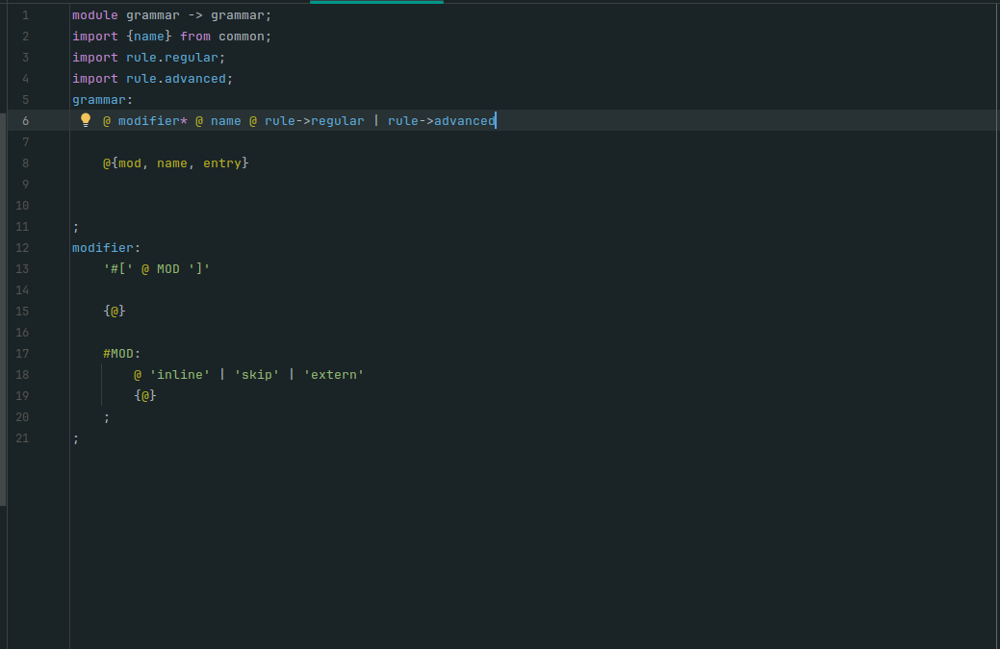
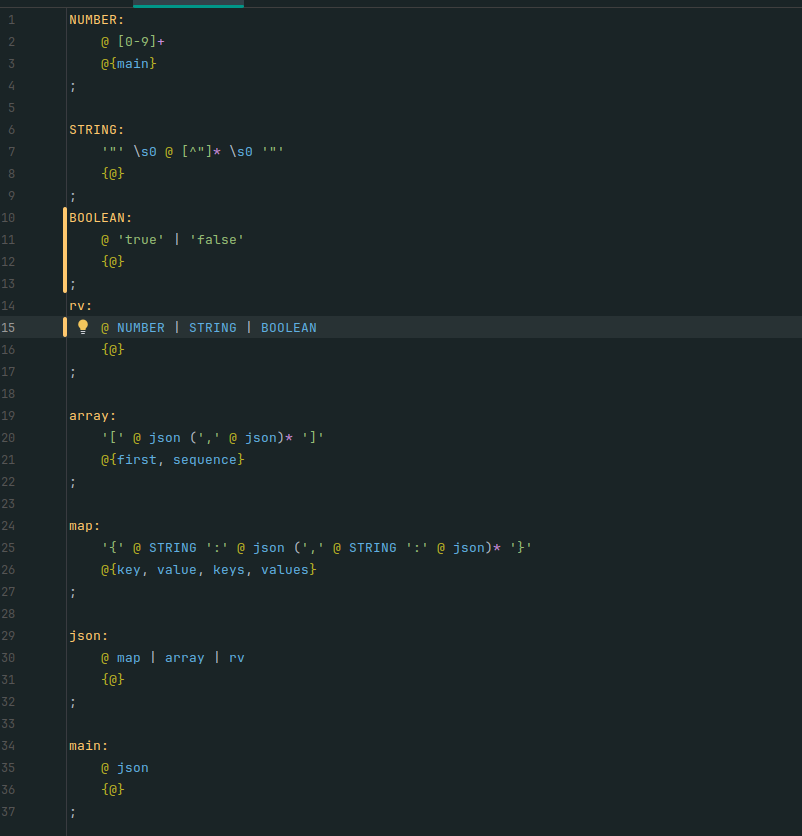

# ISPA Parser Generator

**ISPA** is a static parser and lexer generator written from scratch in modern C++ (C++20/C++23). You describe a grammar once; ISPA compiles it ahead of time into a standalone, dependency-free parser that builds a fully typed AST for you.

It is built around one idea: **easy to use, without giving up performance, extensibility, or features.** In benchmarks it is about 12x faster than ANTLR; see [Performance](#-performance).

---

## Why ISPA

1. **Static generation.** Everything is computed at generation time. The grammar is compiled to DFA tables and plain code. Nothing is generated, interpreted, or compiled at runtime.
2. **No dependencies.** A generated parser is self-contained. Drop the output into your project and build it; there is no runtime library to link or install.
3. **Multi-language output.** Code generation goes through **LangAPI**, a language-agnostic IR, so the same grammar can target different languages. **C++17** is the only emitter today; Python is next.
4. **Actions and error handling live next to the grammar, not inside it.** Semantic actions and fail blocks are separate constructs attached to rules by reference, so the grammar stays readable. *(Syntax is parsed; code generation for these is in progress, see [Status](#-current-state).)*
5. **Scales from trivial to very large projects.** Incremental compilation regenerates only the parts that changed, and the planned module system lets you import, parametrize, and disable features of large shared grammars.
6. **Works out of the box.** Generate, include, call. The generated API returns a typed AST with no post-parsing step or callbacks required.

---

## 🚀 Current State

| Area | Status |
|---|---|
| Compiler (frontend + backend) | Implemented; builds on **Windows** and **Linux** |
| Bootstrap | **Done.** ISPA's own grammar is parsed by an ISPA-generated parser, which fully replaced the hand-written one |
| Lexer (TDFA, AST-building tokens, acceptance-time Python actions) | **Done** |
| Parser (default mode) | Mostly correct; needs some changes and more tests |
| Parser (LR-family modes) | Experimental; not yet stable |
| Incremental generation | Implemented (regenerates changed parts only) |
| C++17 target | Implemented; output compiles and runs |
| Python semantic actions | Executable in LL advanced parser rules; Python subset supported by LangAPI |
| Fail blocks (`fail name>(...) { ... }`) | Executable for required LL parser matches |
| Dynamic regex (back-references, counts from earlier captures) | Syntax parsed, **not yet lowered to output** |
| Grammar syntax error reporting | Automatic LL recovery and source diagnostics; syntax errors stop generation |

The backend lowers **plain EBNF plus AST captures** to C++. LL also executes advanced parser rules and fail blocks with direct Python bodies and invocation-local `ctx` objects. The remaining grammar features above are being integrated into lowering.

---

## 🔁 Bootstrap

ISPA is self-hosting for its own grammar. The `.isc` grammar that describes ISPA's input language was compiled by ISPA into the parser that ISPA now uses to read grammars, replacing the original hand-written parser. A Python-subset parser and a small module-scanner parser are generated the same way.

The generated bootstrap parser is committed to the repository in `parser/ispa/bootstrapped_0`. It consists of two monolithic files (not incrementally compiled) that ship with the repo and are compiled as part of the ISPA build, before ISPA can compile any other grammar.

<!-- TODO: optional, add the generated grammar's size (rules, tokens, lines) -->

## External parsers

An external import calls a separately generated parser and captures its original
node type:

```isc
import extern python ispa_python as python;
expr: @ python.expr {@};
```

Use `--dep NAME PREFIX` to select an existing parser. `PREFIX` has no extension;
ISPA reads `PREFIX.ispa-export` for exported symbols and uses `PREFIX.h` as its
public header. For example:

```sh
ispa -l cpp -a LL --dir parser/ispa/grammar parser/ispa/entry.isc \
  --dep python parser/python/bootstrapped/PyRawParser -o build/Parser
```

The generated C++ includes `<PyRawParser.h>` and uses `PyRawParser::Types`
directly. Add the dependency directory to the compiler's include path and link
its implementation as a static or shared library. The host does not generate
copies of the imported parser's productions or types. Export entry declarations
live in the dependency header; their definitions live in its `.cpp` file.

With `--no-dep`, ISPA discovers external grammar modules in the supplied `--dir`
directories and generates each dependency beside the host, using the external
dependency name as its output prefix. Dependencies remain separate `.h`/`.cpp`
files and must be compiled and linked by the build system. Nested dependencies
are generated before their consumers; dependency cycles are diagnosed. Explicit
`--dep` bindings may supply existing libraries while `--no-dep` builds the rest.

External parser calls currently require LL generation and lazy tokenization.
An eager lexer rejects grammars containing external calls with an `AMBIGUOUS`
diagnostic. Lazy calls re-lex the imported span with the target lexer so token
payloads match the target parser, then resume the host lexer at the returned
source position.

---

## ⚡ Performance

Lex + parse of the same input, compared against flex + bison (LALR(1)) and ANTLR (C++ target). Lower is better; the multiplier is relative to flex + bison without an AST.

| Configuration | Notes | Time per iteration | Relative |
|---|---|---|---|
| flex + bison, no AST | Lex + LALR(1) parse, recognizes only | 119 ms | 1.0x |
| flex + bison, AST, arena allocator | 3.36 M nodes, bump allocation | 151 ms | 1.3x |
| flex + bison, AST, malloc | 3.36 M nodes; parse 219 ms + tree release 40 ms | 259 ms | 2.2x |
| **ISPA**, allocations stripped | | 400 ms | 3.4x |
| **ISPA**, full AST | | 1528 ms | 12.8x |
| ANTLR (C++), CST construction disabled | | 18,573 ms | 156x |

What this shows:
- ISPA with a full AST is about **12x faster than ANTLR**, which was benchmarked with CST construction disabled.
- ISPA is currently **slower than flex + bison**, roughly 6-10x when the latter builds a comparable AST. Closing that gap is ongoing work.

Flex + bison figures are steady state over 10 iterations.

- input: 9.7 MB
- machine processor: intel core i5 12450h laptop
- compiler: clang18, -O3
- OS: GNU Linux – Linux Mint
- ANTLR: 4.13.2
- flex: 2.6.4
- bison: 3.8.2
- single run
---

## Lexer Capabilities
- Matches tokens with a compact **TDFA** (tagged DFA) table, which keeps captures and actions inside a single automaton
- Builds AST-like tokens natively during lexing. **Capture only what you need**
- Semantic actions can be placed anywhere in a token; context-sensitive lexing is possible *(needs Advanced Rules)*
- Matches tokens inside other tokens without losing structure, preserving each capture's data type
- Matches non-terminals inside terminals during lexing, separately from parsing *(not yet implemented)*

## Parser Capabilities
- Generates parsers from the grammar ahead of time. The default parser mode is the stability target; alternative LR-family modes are experimental
- Builds a fully typed, easy-to-traverse AST during parsing. No post-parsing pass or callbacks required

## Shared by both
- Nested rules, where one rule can encapsulate another
- Semantic actions written as in-grammar Python pseudocode, with advanced rules *(in progress)*
- Custom, context-sensitive error messages and recovery through fail blocks *(in progress)*

## Syntax example

Advanced parser rules execute Python blocks between `match` statements when
using the LL C++ backend. Their `ctx.ast` object becomes the rule's returned AST,
so another rule can capture it in the usual way:

```isc
A: 'a';
main: @ item {@};
item {
    ctx.ast.count = 0
    match A -> captured;
    ctx.ast.token = captured
    ctx.ast.count += 1
}
```

`ctx.pos` is the writable current token cursor; saving and restoring it controls
where the next match starts. `ctx.ast` is the writable result being built.
`ctx.start_pos` is a read-only copy of the rule-entry cursor, and `ctx.rule` is
the read-only qualified name of the current rule. AST fields are inferred from
assignments of literals, match bindings, and simple expressions. For other
expressions, declare a field with a Python annotation, for example
`ctx.ast.count: int = compute_count()`. Supported primitive annotations are
`int`, `float`, `bool`, and `str`. A bare `return` or `return ctx.ast` returns the
current result early. Locals persist between sequential Python blocks.

Python helpers can also live in ordinary `.py` files next to the importing
grammar. `import py helpers;` loads `helpers.py`; dotted paths such as
`import py package.helpers as h;` load `package/helpers.py`. Imports are scoped
to the grammar file that declares them. Imported functions and variables are
lowered into generated C++ under `python::helpers` (or
`python::package::helpers`), without a Python runtime.

```python
# helpers.py
FACTOR = 2

def scale(value: int) -> int:
    return value * FACTOR
```

```isc
import py helpers as h;
main {
    match 'x';
    ctx.ast.result = h.scale(21)
}
```

The initial subset supports functions with annotated parameters and returns,
initialized module variables, and the expressions and control flow supported
by ISPA's Python lowering. Types include `int`, `float`, `bool`, `str`,
`list[T]`, `dict[K, V]`, and imported class names; function returns can also be
`None`. Literal module variables can omit their annotation. Classes support
fixed typed fields, `__init__`, instance methods, `@staticmethod`, and public
inheritance. Constructor assignments can infer a field from a typed parameter
or scalar literal; use `self.field: T = value` for other initializers.
Helper files may use `from .internals import Token, RawToken, TokensToString`
to access the native parser and ISPA standard library names declared in
`parser/pystdlib/internals.py`. The file uses `__ispa_internal__("Cxx.Name")`
directives; `__ispa_parser__` denotes the generated parser namespace. The
converter resolves these names to C++ symbols without
emitting Python declarations. Native template types can be annotated as
`RawToken[T]`. Other Python imports inside helper files, other decorators,
default parameters, and general keyword arguments are rejected with source locations. Imported
function return types participate in AST field inference.

Lists support `append`, `extend`, `insert`, `remove`, `pop`, `clear`, `copy`,
`count`, `index` (including start/stop bounds), `reverse`, and stable `sort`
(including a function `key` and `reverse=True`). Dictionaries support `clear`, `copy`, `get`,
`setdefault`, `pop`, `update`, `keys`, `values`, `items`, and
`fromkeys(keys, default)` (on `dict` or a dictionary instance).
`update` also accepts keyword entries. `get` and `setdefault` require an explicit
non-None default. `keys`, `values`, and `items` return snapshots. ISPA maps
are unordered: insertion ordering, live dictionary views, and `popitem` are
unsupported. Collection calls
use LangAPI method operations; target converters emit native operations or
ISPA standard-library helpers for Python-specific behavior.

Fail blocks run for required matches selected by `%handler` or a rule's
`%{handler}` binding. Their context shares the owning rule's AST and the failure
cursor, and additionally exposes the read-only `ctx.failed_rule` qualified name
of the expected production. `ctx.start_pos` still identifies the owning rule's
entry. Moving the failure cursor requests a retry of the required match; leaving
it unchanged accepts a missing value and continues. Retries are bounded by the
runtime. Optional or zero-or-more matches do not invoke fail blocks.

`ctx.at("=")` checks literal spelling. `ctx.at(ID)` and `ctx.at("ID")` also
check token names; dotted or `::` qualified names are accepted. An unqualified
name matches the token's final name component, while a qualified name matches
the corresponding suffix of its full name. Bound variables passed to `at`
retain their values.

`ctx.sync("}", ";")` scans a lazy source cursor to an enclosing boundary,
respecting nested Python delimiters, quoted strings and comments. It leaves
the boundary for its owner. A listed semicolon is a hard boundary even inside
an unclosed container. Scanning is limited to 4096 source bytes and the shared
skip budget; exhaustion aborts recovery. Follow it with `ctx.insert()` to accept
a missing expression instead of retrying the boundary. Eager token streams
cannot use `sync`.

`ctx.sync_tokens("NEWLINE", "DEDENT")` scans tokens instead of source bytes.
It accepts one or more nonempty string literals, matched by spelling or token
name with the same qualification rules as `ctx.at`. It leaves the first matching
token for its owner and stops at EOF. It works with eager and lazy token streams,
including synthetic indentation tokens. Every skipped token counts against the
shared skip budget; exhaustion aborts recovery. It does not balance delimiters:
include all boundaries that must be preserved. Follow it with `ctx.insert()` to
accept a missing value, or `ctx.retry()` to retry at the boundary.

Fail blocks can report `ctx.error("message")` and explicitly choose a repair:
`ctx.skip()` skips one token; `ctx.insert()` accepts a missing value;
`ctx.replace()` skips one token and accepts a missing value; `ctx.retry()` retries
the required match; `ctx.abort()` stops recovery. An abort cannot be undone by
`insert`, `retry`, or another synchronization call. These methods are available
only in fail blocks, and diagnostics remain in the owning parser's `getErrors()`.

Python expressions are direct: `${(a + 2) * b}`, `&= { count: 3 }`, and
`{value}`. Expression entry points do not accept `p{...}` wrappers. Recovered
missing expressions remain invalid and cannot be compiled.

```isc
fail missing {
    ctx.ast.missing = ctx.failed_rule
}
item {
    match %missing A;
}
```

Parser action contexts belong to one invocation and must not escape it. With
the LL C++ backend, advanced token rules may combine `match` patterns with Python actions.
The actions run in source order when the complete token is accepted, after its
capture values are available. They may update fields on `ctx.ast`; `ctx.rule`
and `ctx.start_pos` are read-only. A new field needs a primitive annotation
when its type cannot be inferred from a literal or local expression. Token
actions cannot move `ctx.pos` or return early, and cannot change which pattern
matches. An advanced token must contain a `match` and cannot be embedded inside
another token. Advanced rules in the LR-family backends remain unsupported.

Token actions may also use `ctx.shared.<field>` for state shared by successive
tokens of one lexer instance. Declare a field with a Python type annotation,
such as `ctx.shared.indents: list[int]`, in a token rule that uses it. Declarations
of the same field across rules must agree. A literal assignment also provides a
type for existing grammars. `ctx.text` contains the accepted token's source text,
`ctx.line_prefix` the text before it on the current line, and `ctx.next_char`
the character immediately after it (or an empty string at EOF). Calling
`ctx.emit('TOKEN')` queues a zero-width token after the current token, and
resolves its name in the current grammar module; a dotted name selects a token
in another module.
`ctx.skip()` suppresses the current token, while `ctx.error('message')` rejects
the input. An advanced `END_INPUT` token with
`match '';` runs its actions at EOF, before queued tokens and the EOF marker are
emitted. Together these let grammar actions maintain an indentation stack and
emit `INDENT` and `DEDENT` without a custom lexer subclass.

Parameters use an explicit `>` marker: `name>(arg)` supplies parameters, while
`name (other_rule)*` starts a separate grammar group. This also applies to
declarations and fail-block names; with template parameters, write `name<T>>(arg)`.



## Quick start

Ispa json grammar example:

you can find it [here](tests/input/parser/basic/json.isc)

Generate a parser from a grammar:
```sh
ispa tests/input/parser/basic/json.isc --lang cpp -o output/json
```

Compile it without cmake:
```sh
clang++ -std=c++17 -I parser/stdlibs -I output parser/stdlibs/src/core.cpp output/Parser.cpp examples/main.cpp
```

Run it:
```sh
./a.out --file your_json_file.json
```
Note that you can generate test json with:
```sh
python3 examples/json/generate_json.py -o huge_100mb.json -s 100 -d 2
```

---

## 🔮 Future Roadmap

- [x] **LL advanced parser actions and fail blocks** with writable cursor and AST contexts
- [ ] **Lexer/LR actions and dynamic regex** in generated code
- [ ] **Clean grammar syntax error reporting**
- [ ] **PLL algorithm**: finalize the custom Predictive LL algorithm to resolve left recursion in LL parsers while keeping structural parity with LR parsers
- [ ] **Multi-target code generation**
  - [ ] Python target emitter
- [ ] **Full LR parser stabilization**: LR(1), LALR, and related modes
- [ ] **Modules**: feature-gated modules, `disable feature X`, parametrized modules
- [ ] **Grammar standard library**: JSON, XML, math expressions, C-like statements
- [ ] Features described in **concepts/**

---

## 🛠️ Build & Requirements
1. Clang with libc++ on the latest Ubuntu
2. MSVC `cl` on Windows
3. CMake, exact version 4.3.2

**Note: you will not be able to build ISPA with GCC yet.**
**Note: the Clang build is not tested on Windows.**

### Build on Ubuntu
Configure. **Change `ISPA_SOURCE_DIR` to your local path:**
```sh
export ISPA_SOURCE_DIR=/path/to/ispa-parser
export CC=clang-20
export CXX=clang++-20
export CFLAGS="-stdlib=libc++"
export CXXFLAGS="-stdlib=libc++"
export LDFLAGS="-stdlib=libc++"
cmake -B cmake-build-release \
  -DCMAKE_BUILD_TYPE=Release \
  -DCMAKE_TOOLCHAIN_FILE=~/vcpkg/scripts/buildsystems/vcpkg.cmake \
  -DVCPKG_CHAINLOAD_TOOLCHAIN_FILE=$ISPA_SOURCE_DIR/cmake/toolchains/clang-libcpp.cmake \
  -DVCPKG_TARGET_TRIPLET=x64-linux-libcxx \
  -DVCPKG_OVERLAY_TRIPLETS=$ISPA_SOURCE_DIR/cmake/triplets
```
Build:
```sh
cmake --build cmake-build-release
```

### Build on Windows
- Change `CMAKE_TOOLCHAIN_FILE` to your vcpkg installation path if this does not work
- You might need to set `CMAKE_CXX_COMPILER` to `cl.exe`
- You might need to configure other variables MSVC requires
```bat
cmake -B cmake-build-release -G Ninja -DCMAKE_BUILD_TYPE=Release -DCMAKE_TOOLCHAIN_FILE="%VCPKG_INSTALLATION_ROOT%/scripts/buildsystems/vcpkg.cmake"
cmake --build cmake-build-release
```
